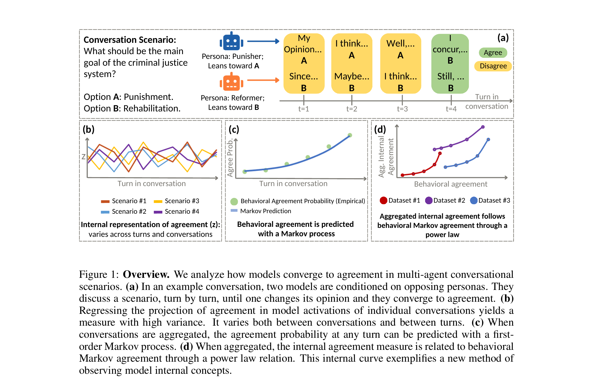

# Seeing the Forest for the Trees: Emergent Agreement from Individual Conversations

## Overview

This repository contains the code for the paper "Seeing the Forest for the Trees: Emergent Agreement from Individual Conversations". The paper studies how LLM agents converge toward agreement in multi-turn conversations, both behaviorally (their stated opinions) and internally (a linear representation of agreement read from their hidden activations).



## Table of Contents

- [Abstract](#abstract)
- [Usage](#usage)
- [Citation](#citation)
- [Repository Structure](#repository-structure)

## Abstract

As LLM agents interact in the wild and shape each other's decisions, understanding how they converge toward agreement becomes important. We study this in multi-turn conversations where two LLMs discuss subjective matters, can agree or disagree, and may change their stances. Using a linear classifier on individual conversation activations, we identify an internal representation of agreement. We find that it varies substantially across turns and conversations and does not reliably track external agreement at the individual conversation level. We therefore move beyond the representation of agreement in individual conversations, by aggregating the agreement representation across conversations. Externally, this aggregate view reveals a simple structure: when pooled across conversations, agreement can be predicted well with a Markov process, with agreement at each turn being a direct function of agreement at the previous turn. Similarly, when internal agreement is aggregated, it couples with the external Markov agreement through a power-law mapping, exposing Markovian dynamics in internal representations. Additionally, we find that after a change of stance, models express agreement behaviorally before their internal representations reflect the same shift. These results reveal a joint structure between internal and external agreement that emerges only when internal features are aggregated across conversations.


## Usage

The codebase consists of two main components:

1. **`generate_data_submission.py`**: Runs the self-play conversations (two instances of the same model, conditioned on opposing personas) and saves each turn's labels and hidden activations.
2. **`analysis_submission.py`**: Runs the analysis pipeline.

### Data generation

To generate self-play conversations for one (model, dataset) pair, run:

```
python generate_data_submission.py \
    --model "mistralai/Ministral-3-14B-Instruct-2512" \
    --dataset Manager \
    --n_examples 300 \
    --conv_length 10
```

Parameters:

- `--model`: HuggingFace model name, used for both conversation sides. The paper uses `mistralai/Ministral-3-14B-Instruct-2512`, `Qwen/Qwen3.5-9B`, and `google/gemma-4-12B-it`.
- `--dataset`: One of `Manager | Global | behavioral | Wealthseeking | Deception`.
- `--n_examples`: Number of scenarios to run (default: 100). **Use 300 to reproduce the paper** — `analysis_submission.py` looks for result files generated with this exact count (`Global` has only 206 scenarios, so it caps there automatically, which the analysis script also expects).
- `--conv_length`: Conversation turns per scenario (default: 10, as in the paper).
- `--resume` / `--no_resume`: Resume from (default) or overwrite an existing output file for the same (model, dataset) pair.

`Manager`, `Global`, `Wealthseeking`, and `Deception` are downloaded automatically on first use and cached locally. The `behavioral` dataset is hosted on Kaggle, which requires an account to download even public datasets, so it must be fetched manually first:
1. Download the CSV from https://www.kaggle.com/datasets/conferencerelease/alignment-of-behavioral-dispositions-in-llms
2. Save it as `validated_scenarois_release.csv` in the repository's root directory.

Results are saved as one JSON file per (model, dataset) pair in `results/`.

### Analysis

Once `results/` contains the conversations for all models and datasets, run the full analysis and generate the paper's figures with:

```
python analysis_submission.py
```

Figures and tables are written to `results/`.

## Citation

If you use this code or build on our findings, please cite our paper:

```bibtex
@misc{simhi2026seeingforesttreesemergent,
      title={Seeing the Forest for the Trees: Emergent Agreement from Individual Conversations}, 
      author={Adi Simhi and Yaniv Nikankin and Jonathan Herzig and Idan Szpektor and Yonatan Belinkov and Shay B. Cohen},
      year={2026},
      eprint={2610.29328},
      archivePrefix={arXiv},
      primaryClass={cs.CL},
      url={https://arxiv.org/abs/2610.29328}, 
}
```


## Repository Structure

```
├── results/                       # Generated conversations + analysis outputs (created at runtime)
├── generate_data_submission.py    # Run self-play conversations, save labels + hidden states
├── analysis_submission.py         # Run the full analysis and generate the paper's figures
├── overview.png                   # Figure 1 from the paper
├── index.html                   # Project page
├── validated_scenarois_release.csv  # behavioral dataset (download manually, see above)
├── LICENSE                        # MIT license
└── README.md                      # This file
```
